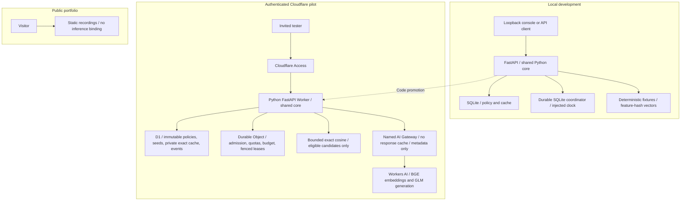
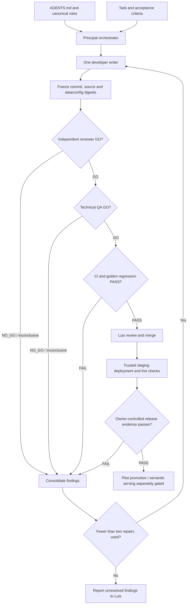

# Warmstart architecture

## System

The dotted edge is code promotion, not a runtime call. `warmstart.core` depends on async
protocols. `warmstart.api` alone bootstraps SQLite and the loopback identity. The Worker
imports `warmstart.web`, `cloud`, `ledger` and `access`, keeping the local bootstrap out of
the runtime path. Platform conversion and WebCrypto live in `src/worker.py`.

The Worker compatibility date pins the supported Python 3.13 ABI. Pydantic is pinned to
the available Pyodide wheel version and exercised locally at the same version. Review both
lockfiles and rerun adapter/live gates when upgrading; a date change can change the Python ABI.

Cloudflare adapters have CPython contract tests. Those tests simulate binding contracts;
the Worker build and a real hosted integration run are separate evidence requirements.

## Request and compatibility boundaries

1. Verify the Access JWT signature, issuer, audience, expiry and trusted membership.
2. Admit against the coordinator's active policy pointer and daily quota.
3. Load that immutable edition; unsupported qualifiers or mixed conditions clarify/bypass.
4. Look up a subject-private exact key: configuration + profile + edition + normalized question.
5. If enabled, validate Gateway transport, reserve embedding spend, embed through Gateway
   and rank only eligible scoped seeds.
6. Shadow records a potential match; serving additionally requires approval and release evidence.
7. On a miss, acquire a fenced generation lease, validate transport and reserve spend before
   every Gateway generation attempt.
8. Validate bounded output and the source for the classified fact, store a private exact entry,
   return admitted version/status/ID, and attempt bounded redacted telemetry.

The profile encodes shop, country and customer tier. The pilot supports English questions
only. The response-compatibility signature includes prompt, model, generation settings, schema,
embedding model/pooling/normalization, admission threshold and TTL. Operational inference,
search-mode and deadline switches are recorded in full configuration fingerprints but do
not strand valid private exact entries. To revoke previously materialized answers after an
incident, disable exact caching or change the relevant content/admission compatibility version.
Normalization changes whitespace/case only.
Unknown qualifiers intentionally lower coverage. Regex admission is a bounded FAQ policy,
not a general natural-language understanding or prompt-injection guarantee.

Semantic search currently ranks at most 128 scoped candidates with shared cosine code.
The fixture corpus has five candidates per profile/edition. Production admissions require
`human_approved`, matching embedding fingerprint, review timestamp and unexpired review.
The initial fixtures have no such approval and can never serve in deployed environments.
Generated exact-cache answers remain private; no automatic semantic promotion exists.

## AI Gateway transport

Both deployed inference operations use the same explicitly provisioned Gateway through
`AI.run`'s third argument. Missing/invalid IDs and the special `default` ID fail paid-call
preflight; no direct-inference fallback exists. Gateway transport is separate from answer
compatibility: changing its ID/log mode or disabling inference does not strand valid private
exact entries. Full deployment settings and the transport fingerprint belong in live evidence.

Each request sets `skipCache: true`, preserving Warmstart's cache ownership and benchmark
isolation. Metadata-only mode sets `collectLog: true` with
`cf-aig-collect-log-payload: false`; it requests token/model/status/cost/duration visibility
without stored request/response bodies. No custom metadata, user IDs or raw questions are
attached. `AI_GATEWAY_LOG_MODE=off` suppresses the entire Gateway log, including metrics.
This logging policy does not prevent the inference provider from processing the prompt.
Exact hits bypass all Gateway/model work. A semantic hit still requires its budgeted
embedding call through Gateway unless a separate embedding cache exists; none is implemented.
Gateway metrics do not judge answers or replace golden-set correctness evaluation.
[Gateway binding options](https://developers.cloudflare.com/ai-gateway/usage/worker-binding-methods/),
[payload logging controls](https://developers.cloudflare.com/ai-gateway/observability/logging/).

Set `gateway.retries.maxAttempts: 1` and `cf-aig-max-attempts: 1` for both operations. Preserve
generation's `x-session-affinity` header. Warmstart remains the retry owner: one transient
generation retry at most, with a new durable reservation per attempt. Failure never removes
the Gateway options or retries directly against a model endpoint. Provider prefix caching
remains distinct from Gateway response caching.
[Request-handling controls](https://developers.cloudflare.com/ai-gateway/configuration/request-handling/).

Pinned workerd types expose Gateway retries and `extraHeaders`. Contract tests inspect both
operation payloads; the Worker build and no-AI local smoke establish packaging/runtime
compatibility only. They do not establish hosted routing, payload suppression, billing or
retry behavior. Those remain pre-pilot checks in [Deployment](DEPLOYMENT.md).

Materialized exact entries expire after 24 hours, or sooner if a reviewed seed expires.
Published policy payloads cannot be updated/deleted in D1; use a new edition. The current
demo exposes two editions. Add future editions through an explicit schema/data/API change.

## Storage and coordination

| Store | Data and ownership |
|---|---|
| D1 | Immutable policy payloads, original seed records, private exact entries, redacted events |
| Durable Object | One stable named coordinator per Worker: active version, daily counters, monthly ledger, leases |
| SQLite | Local Store and Coordinator implementations, persisted separately from domain logic |

The Durable Object uses one instance lock plus atomic multi-key storage writes. Reservation
and monthly aggregate commit together. Restart reads the persistent ledger. Settlement is
idempotent, charges the reservation's original month, and retains full actual usage even if
it exceeds a reservation. Uncertain provider outcomes retain conservative reservations.
Never rename the coordinator or delete its storage to reset spending during rollback.

Five fenced leases limit overlapping generations; expiry must outlive the 20-second
orchestration timeout including admission. Access key lookup has a separate two-second limit;
best-effort cleanup can add up to 0.5 seconds. Hosted end-to-end deadline behavior remains
a release check. There is at most one transient
generation retry, with another reservation.
Lease expiry limits duplication but cannot promise exactly-once provider billing after a
crash. Embeddings are separately budgeted. D1/coordinator reads fail closed. Telemetry and
lease release are bounded best-effort; the durable ledger is authoritative for spending.

Events omit raw questions, prompts and answers. Confirmed/estimated event cost does not
include uncertain reservations. Owner metrics expose the coordinator ledger separately.
BGE usage may be estimated from a conservative byte bound and is explicitly labeled.

## Development agents

Agents build this deterministic runtime; customer requests do not invoke autonomous agents.
Instructions are shared across tools, with distinct native role names. An evidence recorder
enforces sequence and repair limits locally, but cannot prove commands ran or agents were
independent. CI, protected environments and Luis's review remain actual enforcement.

## Architecture decisions

- D1 plus exact cosine is sufficient for 60–80 small reviewed candidates. Defer Vectorize
  until measured size/latency justifies it; compare before promotion.
- Use Cloudflare bindings behind adapters; no extra server, Redis or agent framework is
  needed for this bounded pilot.
- Workers AI models are explicitly configured. A change requires new pricing checks,
  embeddings/fixtures where relevant and live evaluation. Prefix caching is provider-owned;
  count cached input tokens separately from avoided generation calls.
- Gateway routing is explicit; its response cache is bypassed. Minimal metadata logging is
  requested without payloads, and Gateway retries cannot multiply the application retry loop.
- The public demo serves assets only. Its deployment config has no AI, D1 or coordinator
  binding and cannot exercise paid inference.

References: [Python FastAPI Workers](https://developers.cloudflare.com/workers/languages/python/packages/fastapi/),
[Python D1](https://developers.cloudflare.com/d1/examples/query-d1-from-python-workers/),
[Durable Object storage](https://developers.cloudflare.com/durable-objects/api/sqlite-storage-api/),
[Access application JWTs](https://developers.cloudflare.com/cloudflare-one/access-controls/applications/http-apps/authorization-cookie/application-token/).
